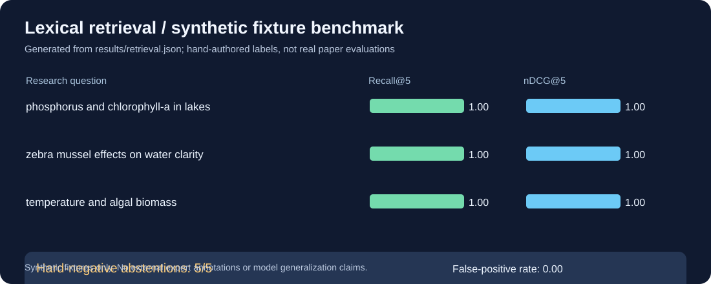
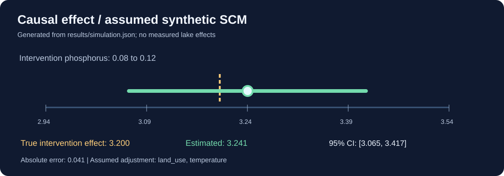
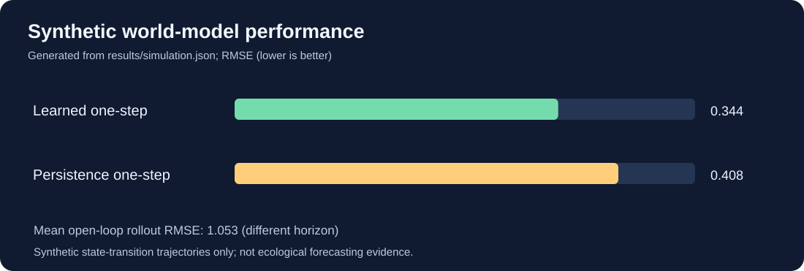
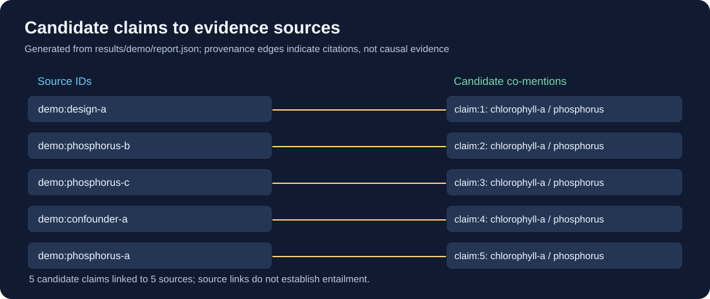

# راهنمای فارسی EcoCausal-Reasoner

**وضعیت پروژه:** نسخه اجرایی پژوهشی (Prototype). کد و تست‌های حالت آفلاین اجرا شده‌اند. داده‌های مثال کاملاً ساختگی‌اند و اثر علّی واقعی درباره دریاچه‌ها گزارش نمی‌شود.


## نمودارهای تولیدشده از خروجی واقعی کد

این چهار تصویر از فایل‌های JSON موجود در مخزن ساخته شده‌اند؛ نه تصاویر مفهومی یا نتایج ادعایی. برای بازتولید همه آن‌ها، اسکریپت [`scripts/plot_results.py`](scripts/plot_results.py) را اجرا کن.

**۱. معیارهای بازیابی روی داده ساختگی**



**۲. اثر علّی تخمینی، مقدار واقعی مدل مصنوعی و بازه اطمینان**



**۳. خطای World Model در برابر مدل مبنا**



**۴. ارتباط ادعاها با شناسه منابع در گزارش Demo**



برای تولید مجدد تصویرها در ریشه مخزن:

```bash
ecocausal demo --output results/demo
ecocausal evaluate --output results/retrieval.json
ecocausal simulate --output results/simulation.json
python scripts/plot_results.py
```

منبع داده‌ها: [`results/retrieval.json`](results/retrieval.json)، [`results/simulation.json`](results/simulation.json) و [`results/demo/report.json`](results/demo/report.json).

**محدودیت علمی:** همه داده‌های این نمودارها مصنوعی هستند و هیچ‌کدام دقت روی مقالات واقعی، اجرای LLM یا نتیجه علّی درباره دریاچه واقعی را ثابت نمی‌کنند.

## اجرا روی Linux Mint

```bash
python3 -m venv .venv
source .venv/bin/activate
python -m pip install -e '.[dev]'
pytest -q
ecocausal demo --output results/demo
ecocausal evaluate --output results/retrieval.json
ecocausal simulate --output results/simulation.json
```

برای افزودن مقاله واقعی، `ecocausal ingest-pdf` یا `ecocausal fetch-openalex` را اجرا کن. فایل‌های PDF خصوصی یا دارای حق نشر را در GitHub منتشر نکن.

برای Hugging Face + FAISS + CrossEncoder ابتدا `pip install -e '.[semantic,transformers]'` را اجرا کن؛ مدل‌ها باید دانلود شوند. برای Ollama، گزینه `--llm` به سرور محلی متصل می‌شود و باید اجرای واقعی آن جداگانه آزمایش شود. برای LoRA به RAM/VRAM مناسب نیاز داری.

برای شواهد دقیق درباره ۱۶ کلمه کلیدی، فایل `docs/KEYWORD_COVERAGE.md` را بخوان. صرف داشتن اسکریپت به معنی گذراندن آزمون عملی یا علمی نیست.

## ممیزی پیش از انتشار

**نسخه ۰.۲.۰؛ ۵۹ تست موفق.** این تست‌ها به معنی تسلط عملی بر همهٔ ۱۶ مهارت نیستند. سؤال بی‌ربط در بازیابی واژگانی دیگر شواهد ساختگی برنمی‌گرداند. برای جدول دقیق، `docs/PREPUBLISH_AUDIT_FA.md` و `docs/PREPUBLISH_AUDIT.md` را بخوان.

**اصلاح مهم:** پرسش‌هایی که فقط چند واژه عمومی با منابع اشتراک دارند نباید خودکار شواهد دریافت کنند. پنج تست منفی مصنوعی اکنون بدون سند برمی‌گردند. در حالت نبود شواهد، فایل اثر علّی مصنوعی همراه گزارش سؤال تولید نمی‌شود. این معیارها روی مقالات واقعی اعتبارسنجی نشده‌اند.

## انتشار در GitHub

فایل‌های این پوشه برای انتشار عمومی به‌عنوان **پروتوتایپ آفلاین با داده مصنوعی** آماده شده‌اند. قبل از انتشار `docs/PUBLISH_GITHUB_FA.md` و `docs/RELEASE_CHECKLIST.md` را بخوان. هیچ فایل PDF خصوصی، رمز، وزن مدل یا داده با مجوز نامشخص را به مخزن اضافه نکن. بعد از Push حتماً نتیجهٔ GitHub Actions را در خود GitHub کنترل کن.
