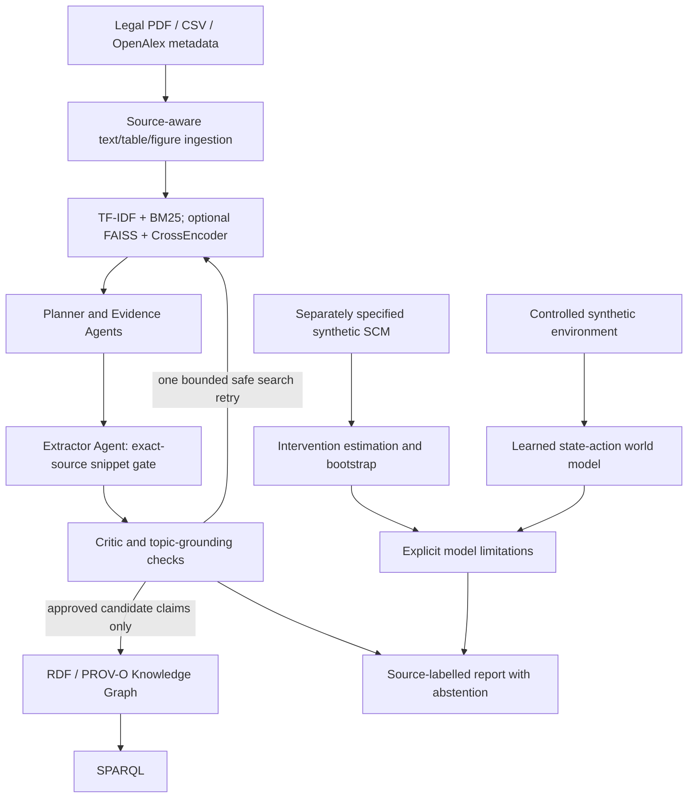

# Architecture and safety contract

## Boundaries

1. **Source layer**: A PDF text block is attributable to a file hash and page number. An OpenAlex abstract is attributable to a work identifier and DOI/URL; text can still be wrong. Image captions from BLIP are generated guesses and are never treated as measured observations.
2. **Extraction layer**: Offline heuristic emits co-mentions, never `causes`. Live LLM relation outputs require a verbatim supporting quote that mentions both entities and an allowed source ID; the unverified predicate still represents reported text, *not accepted scientific causality*.
3. **Graph layer**: RDF objects are claims and textual assertions with `prov:wasDerivedFrom`. The graph is not automatically converted into a causal DAG.
4. **Causal layer**: DAG is independently hypothesized and assumed correct for the synthetic benchmark. A backdoor set is tested by d-separation on the backdoor graph. Bootstrapping reflects only sampling variability of this invented DGP.
5. **World model**: A Ridge model learns state(t), action(t) -> state(t+1) from a scripted simulator. The action is exogenous; the model is not calibrated to EPA lakes.
6. **Human evaluation**: Blank template is intentionally blank. Only human-entered double ratings may be used for kappa.
7. **LLM**: When enabled, Planner, Extractor, Critic each make a separate local Ollama call and exchange structured outputs through the coordinator. Unit tests with mock LLM validate the wiring only.

## Agent and evidence contracts

- **No arbitrary tool execution**: agents only call predefined retrieval, extraction, graph and synthetic analysis functions.
- **No hidden model substitution**: if semantic/LLM packages are absent, requested semantic/LLM mode throws a clear error; it does not silently run lexical baseline.
- **No infinite retries**: at most one critic-directed retrieval retry.
- **No fake scores**: no reviewer ratings or LLM performance metrics are invented.
- **No transfer claims**: synthetic causal and world model outputs must remain explicitly labelled synthetic.
